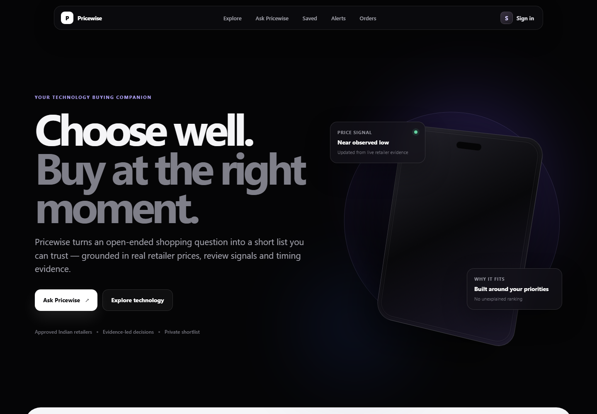
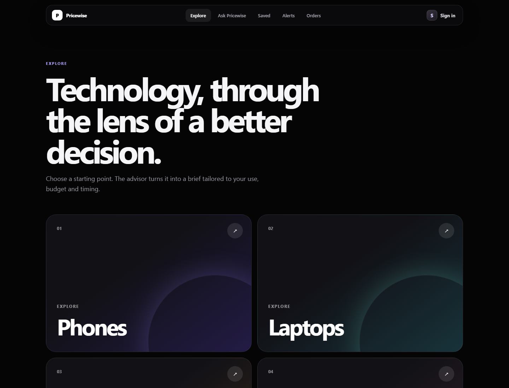
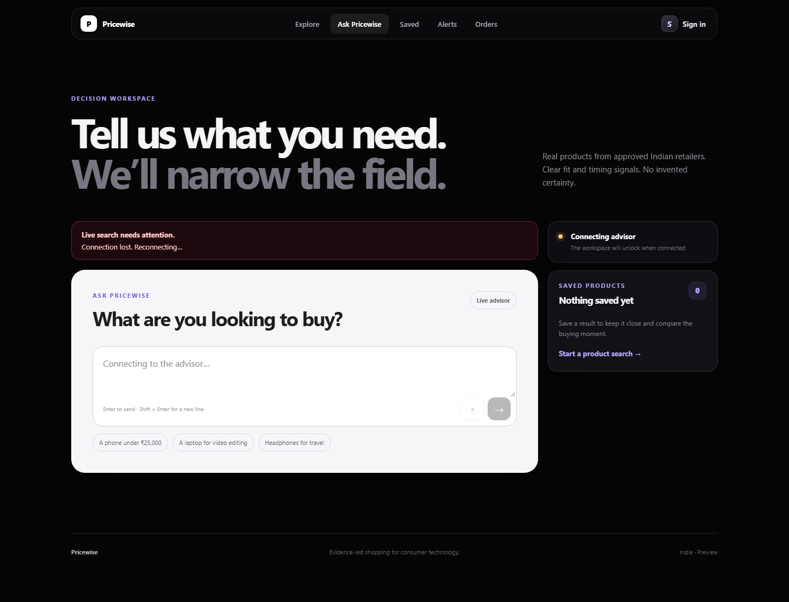
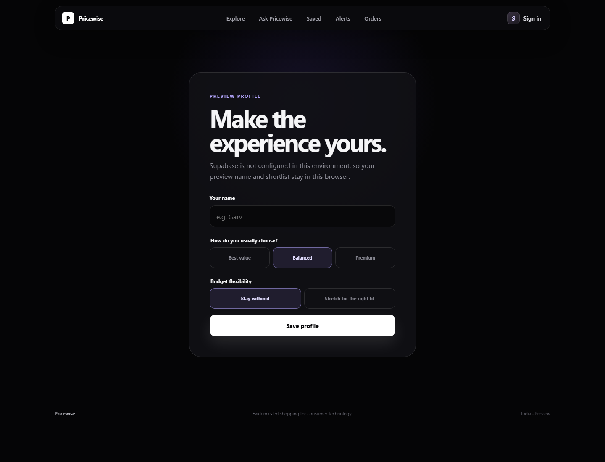
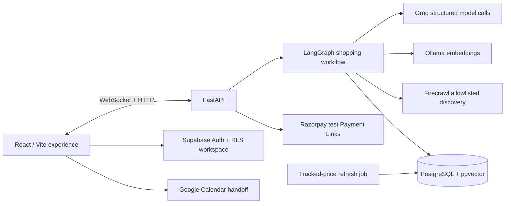

# Pricewise

**A personal technology-buying companion for India.** Pricewise turns a vague shopping question into a short, evidence-backed shortlist, explains whether the timing is right, remembers what the shopper cares about, and stays useful after the purchase.

With the documented free-tier services configured, the MVP supports the complete journey from discovery to after-sales guidance: passwordless accounts, conversational product search, approved-retailer comparisons, review and price signals, saved products, price-drop alerts, purchase handoff, delivery planning, and structured support requests.

<div align="center">


</div>

## The product

Technology shopping usually breaks into disconnected steps: browse dozens of tabs, decode specifications, guess whether reviews are trustworthy, wonder whether a sale is close, then start over when delivery or a return becomes complicated. Pricewise keeps that context in one private workspace.

A shopper can say, “I need a laptop for video editing under ₹80,000.” The advisor asks only the questions needed to narrow the choice, searches approved Indian retailers, ranks matching products around the shopper’s budget and preferences, and presents the evidence behind every recommendation. After a product is selected, Pricewise keeps its price history, records the purchase journey, helps reserve an installation window, and turns a plain-language problem into a useful return, exchange, warranty, or delivery-support draft.

The language model handles conversation and explanation. Prices, retailer links, historical observations, sale windows, and the final `buy_now`, `wait`, or `insufficient_data` outcome remain grounded in retrieved or deterministic data.

## Product experience

### A calm, decision-first home

The interface introduces one clear promise and moves the shopper directly into discovery or the advisor.



### Explore by intent

Explore provides strong starting points without turning the page into a crowded marketplace. Categories can later be reordered or personalized from shopper activity.



### A stateful shopping conversation

The advisor maintains context across turns, shows live search stages, accepts text or browser-supported voice input, and stops clarifying after a bounded number of questions.



### Preferences that shape recommendations

The account experience captures whether a shopper prefers best value, balance, or premium options and whether the stated budget is strict or flexible. Supabase stores these preferences when configured; local preview mode keeps them in the browser.



## What the configured ₹0 MVP can do

- Create passwordless shopper accounts with Supabase and protect private data with row-level security.
- Remember decision style and budget flexibility, then use them in the next advisor conversation.
- Ask bounded follow-up questions and preserve the conversation over a stateful WebSocket session.
- Search only approved Indian retailer domains and cache product evidence in PostgreSQL.
- Carry verified product imagery, price, rating, review count, and retailer links into the result set.
- Rank a concise shortlist and explain why each product fits the shopper’s stated needs.
- Compare recorded price history with known Indian sale windows and return an honest buy, wait, or insufficient-data decision.
- Open a persistent product decision page with evidence, timing, price history, and retailer handoff.
- Save products locally or sync them to the signed-in shopper’s Supabase account.
- Refresh tracked prices with a schedulable backend command and create deduplicated price-drop alerts.
- Start a Razorpay **test-mode** payment handoff without exposing the secret key or trusting a browser-supplied price.
- Record purchase, delivery, installation, and delivered states in an orders workspace.
- Create a Google Calendar event for a chosen installation window.
- Build guided return, exchange, warranty, and delivery-problem drafts with evidence checklists.
- Continue to work in clearly labelled local preview mode when optional account services are absent.

## End-to-end journey


## Architecture



The recommendation workflow is deliberately hybrid:

1. Groq extracts only details the shopper actually stated.
2. LangGraph pauses and resumes when a clarification is needed.
3. PostgreSQL and pgvector provide a cache-first product search.
4. Firecrawl handles a cache miss only across the fixed retailer allowlist.
5. Deterministic code checks history, upcoming sale windows, and evidence quality.
6. Groq phrases the grounded conclusion; it does not choose or invent the underlying price verdict.

## Free-tier MVP configuration

The repository is designed to run as a zero-software-cost MVP within provider free-tier limits. Capacity, inactivity, and rate limits still apply.

| Need | MVP service | Role in Pricewise |
|---|---|---|
| Accounts and cloud data | Supabase Free | Passwordless auth, PostgreSQL, saved products, alerts, orders, support cases, and RLS. |
| Conversational reasoning | Groq Free | Structured intent extraction and concise grounded wording. |
| Retailer discovery | Firecrawl Free | Allowlisted search/extraction when the local product cache misses. |
| Embeddings | Local Ollama | `nomic-embed-text` for similarity search; the machine running it must remain reachable. |
| Frontend hosting | Cloudflare Pages Free | Static Vite frontend and HTTPS provider subdomain. |
| Prototype API hosting | Render Free or equivalent | FastAPI container for demonstrations; free instances may sleep and cold-start. |
| Scheduled refresh | GitHub Actions free allowance | Runs `python -m backend.jobs.refresh_prices` on a schedule. |
| Calendar handoff | Google Calendar | Opens a prefilled event for delivery or installation planning. |
| Payment demonstration | Razorpay Test Mode | Safe checkout-flow demonstration without live settlement. |
| In-browser voice | Web Speech API | Optional voice intake where the browser supports it. |

A custom domain, higher traffic, always-on cloud compute, additional extraction volume, SMS/WhatsApp delivery, and live payment processing are not inherently free.

## Ready in code, gated in the real world

The following product surfaces and internal data models already exist. They are intentionally limited to guidance, test mode, user confirmation, or an external handoff because production activation requires regulation, compliance work, commercial agreements, or private provider access.

| Capability | What is already in place | Why it cannot be fully automated yet | What unlocks it |
|---|---|---|---|
| Live in-app payment | Server-side price lookup and Razorpay Payment Link adapter in test mode. | Live money movement requires KYC, production approval, secure webhook verification, refunds, reconciliation, tax, privacy, and dispute operations. | Approved live Razorpay account plus a reviewed payments and webhook operation. |
| Buying directly from a retailer | Product identity, current price, retailer URL, purchase workspace, and checkout handoff. | Public scraping does not authorize adding to a retailer cart or placing an order for a user. Credentials and consent alone are not a substitute for merchant permission. | Official retailer commerce APIs, merchant agreements, and an explicit user-confirmation flow. |
| Automatic delivery negotiation | Delivery state, preferred date, installation time, and calendar handoff. | Courier and installer booking systems generally require commercial integrations and may expose personal addresses or phone numbers. | Contracted courier/installer APIs, consent, privacy review, and resilient status webhooks. |
| Filing returns, exchanges, or warranty claims | Guided issue classification, support-case persistence, draft text, and evidence checklist. | Retailer claim submission depends on authenticated order ownership, each merchant’s policy, and private returns APIs. | Retailer-authorized returns APIs and a reviewed representation/consent model. |
| Alerts while the app is closed | Persistent alert records, notification centre, price-refresh command, and deduplication. | Browser state alone cannot guarantee out-of-app delivery, and SMS/WhatsApp/email providers require credentials, templates, consent, and often paid usage. | A deployed scheduler plus approved email, push, SMS, or WhatsApp delivery. |
| Predicting near-term prices | Historical observations, known sale calendar, and conservative decision logic. | A retailer’s future price is not knowable from sparse public evidence. Presenting a guess as certainty would be misleading. | More history and verified signals can improve confidence, but the UI must continue to disclose uncertainty. |
| Fully autonomous after-sales agent | A structured workspace that prepares the correct next action. | An agent should not accept terms, spend money, submit a legal declaration, or communicate as the user without explicit authority and review. | Narrow provider actions, visible confirmation before every consequential step, and legal/compliance approval. |

This boundary is part of the product, not missing code. Pricewise can recommend, prepare, organize, and hand off. It must not impersonate the shopper, bypass retailer rules, fabricate price certainty, or complete a consequential action without informed confirmation.

## Supported retailer allowlist

- `amazon.in`
- `flipkart.com`
- `croma.com`
- `reliancedigital.in`
- `mdcomputers.in`

## Configuration

Copy `backend/.env.example` to `backend/.env` and configure:

| Variable | Required | Purpose |
|---|---:|---|
| `GROQ_API_KEY` | Yes | Structured intent and response wording. |
| `GROQ_MODEL` | Yes | Defaults to `openai/gpt-oss-120b`. |
| `FIRECRAWL_API_KEY` | For live cache misses | Allowlisted retailer search and extraction. |
| `DATABASE_URL` | Yes | PostgreSQL database with the included schema and migrations. |
| `OLLAMA_BASE_URL` | Yes | Reachable Ollama server; defaults to `http://localhost:11434`. |
| `RAZORPAY_KEY_ID` | For test checkout | Razorpay test-mode key ID. |
| `RAZORPAY_KEY_SECRET` | For test checkout | Razorpay test-mode secret; server only. |
| `ALLOWED_ORIGINS` | Yes | Browser origins permitted by FastAPI CORS. |

Copy `frontend/.env.example` to `frontend/.env` and configure:

| Variable | Required | Purpose |
|---|---:|---|
| `VITE_SUPABASE_URL` | For cloud accounts | Enables Supabase authentication and workspace sync. |
| `VITE_SUPABASE_PUBLISHABLE_KEY` | For cloud accounts | Browser-safe publishable key; never use the service-role key. |
| `VITE_API_HTTP_URL` | For deployment | FastAPI HTTP origin; locally defaults to `http://127.0.0.1:8000`. |
| `VITE_API_WS_URL` | For deployment | FastAPI WebSocket origin; locally defaults to `ws://127.0.0.1:8000`. |

Apply `database/schema.sql` and migrations `001` through `003` before enabling the complete Supabase-backed workspace.

## Run locally

Prerequisites: Python 3.11+, Node 20+, PostgreSQL with pgvector, and Ollama with `nomic-embed-text`.

```powershell
cd Pricewise
python -m venv .venv
.\.venv\Scripts\python.exe -m pip install -r backend\requirements.txt
.\.venv\Scripts\python.exe -m uvicorn backend.main:app --host 127.0.0.1 --port 8000
```

In a second terminal:

```powershell
cd Pricewise\frontend
npm install
npm run dev
```

Open `http://127.0.0.1:5173`.

## API contract

| Method | Endpoint | Purpose |
|---|---|---|
| `GET` | `/health` | Basic API health check. |
| `WS` | `/ws/chat` | Stateful conversation, graph-stage events, pauses, and final results. |
| `GET` | `/session/{session_id}/history` | Restores a persisted graph state. |
| `POST` | `/payment-link` | Creates a server-side Razorpay test Payment Link for a cached product. |
| `POST` | `/products/prices` | Returns authoritative cached prices for a bounded tracked-product list. |

## Verification

```powershell
cd Pricewise
.\.venv\Scripts\python.exe -m pytest backend\tests -q
.\.venv\Scripts\python.exe -m backend.graph.test_run
cd frontend
npm run build
```

Refresh tracked products manually or from a trusted scheduler with:

```powershell
.\.venv\Scripts\python.exe -m backend.jobs.refresh_prices
```

The current automated backend suite contains 22 passing checks. Deployment-ready backend and frontend Dockerfiles, nginx SPA routing, and the production checklist live in [`docs/RUNBOOK.md`](docs/RUNBOOK.md).

## Repository structure

```text
Pricewise/
├── backend/
│   ├── graph/              # LangGraph state, routing, nodes, and workflow
│   ├── jobs/               # Scheduled tracked-price refresh
│   ├── routers/            # Health, WebSocket, session, payment, and price APIs
│   ├── services/           # PostgreSQL, Groq, Ollama, Firecrawl, Razorpay
│   └── tests/              # Unit, transport, and graph-flow checks
├── database/
│   ├── schema.sql
│   └── migrations/         # Product imagery and Supabase/RLS workspace tables
├── frontend/
│   └── src/                # Discovery, advisor, decisions, alerts, orders, support
├── docs/
│   ├── images/             # Product screenshots
│   └── RUNBOOK.md          # Deployment and operations
├── PRODUCT_PLAN.md
└── README.md
```

## Safety and trust boundaries

- Retailer discovery is limited to a fixed allowlist.
- The advisor uses bounded input and output sizes and rejects unsupported WebSocket events.
- Browser clients send product IDs—not prices—to the payment endpoint; the server re-reads the cached INR amount.
- Signed-in workspace records are isolated with Supabase row-level security.
- The app reports insufficient evidence instead of manufacturing a trend.
- Voice input is optional and falls back to text.
- No current workflow logs into retailer accounts, bypasses checkout controls, or submits a return as the shopper.

See [`PRODUCT_PLAN.md`](PRODUCT_PLAN.md) for the concise delivery status and provider-activation checklist.
